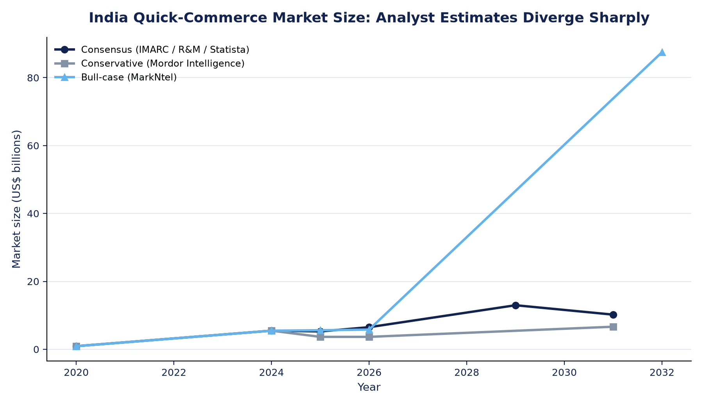
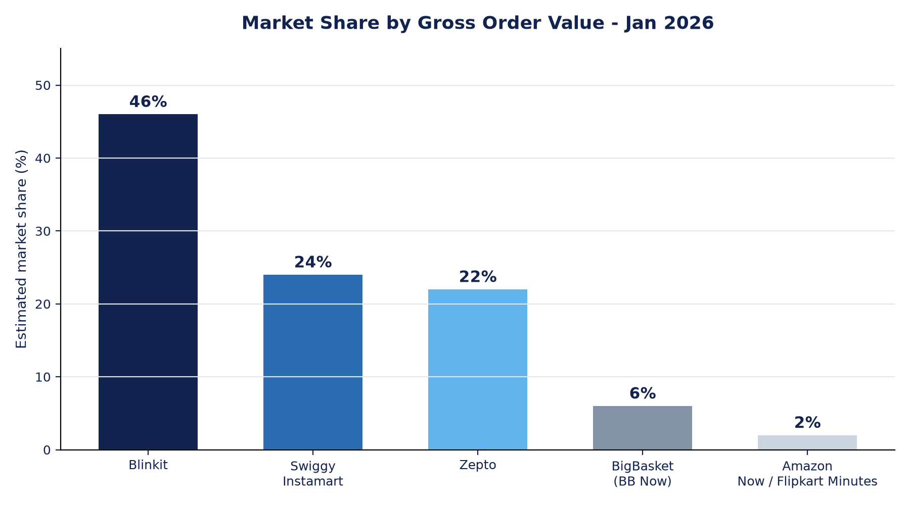
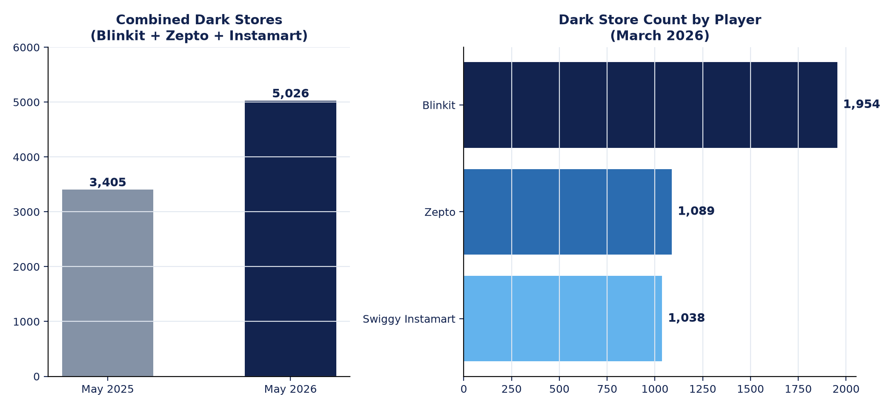

# India Quick-Commerce: Competitive Landscape & Market Analysis

A market research project analyzing India's quick-commerce (q-commerce) sector - the
10-minute delivery platforms (Blinkit, Zepto, Swiggy Instamart, BigBasket, Amazon Now,
Flipkart Minutes) reshaping Indian retail.

Built to practice the kind of market sizing, competitive analysis, and data storytelling
that goes into a venture/product research role: pulling public data, reconciling
conflicting sources, and turning it into a decision-ready view of a market.

## Why this market

Quick-commerce sits at the intersection of a few things I wanted to dig into:
- It's one of the fastest-moving consumer sectors in India right now (40%+ YoY growth in 2026).
- The public data is unusually rich for a private-market sector - funding filings, IPO
  paperwork (Zepto), and scraped dark-store intelligence are all available.
- It connects to an earlier project of mine, a dark-store dispatch simulation, so this
  extends that operational lens into a market/competitive one.

## What's in this analysis

### 1. Market size - and why analysts disagree by 9x

Three credible research firms (IMARC, Mordor Intelligence, MarkNtel) size the same 2032
market anywhere from $6.6B to $87.5B. That's not noise - it reflects real methodological
choices (does "quick commerce" include only grocery, or all instant-delivery categories?).



Takeaway: when a market's public sizing varies 9x depending on the source, the useful
skill isn't picking the "right" number - it's knowing why they disagree and which
definition matches the business question you're actually asking.

### 2. Competitive structure - concentrated, but not settled

As of January 2026, three players account for roughly 92% of gross order value, with
Blinkit roughly double the size of either chaser.



### 3. Infrastructure race - the real battleground

Store count is the leading indicator that matters most here: it determines delivery
radius, catalog depth, and how fast a platform can defend a neighborhood. The combined
dark-store footprint of the top 3 grew 48% in twelve months.



A finding the raw share numbers hide: joining store count against GOV share (see
scripts/sql_analysis.py) shows Blinkit and Instamart each generate more order value per
store than Zepto does - Zepto's share is winning more on store-count growth than on
per-store productivity. That's the kind of gap a pure market-share chart won't show you.

### 4. Key strategic trends (2026)

- Non-grocery expansion - pharmacy, beauty, electronics - to raise basket size and margin.
- Tier-2/3 push as metro density saturates.
- Private label as Blinkit's main margin lever, now that GOV growth alone hasn't
  produced durable profitability.
- Regulatory scrutiny - a government order to stop marketing "10-minute" delivery,
  plus antitrust complaints over alleged predatory pricing.
- Profitability bifurcation - most top-metro stores are profitable; most Tier-2 stores
  still aren't. Aggregate growth is masking a widening gap between winners and laggards.

Full detail and sourcing for each trend is in data/market_data.py.

## Project structure

```
qcommerce-market-analysis/
├── data/
│   └── market_data.py        # single source of truth - all figures, cited inline
├── scripts/
│   ├── build_charts.py       # generates the three charts above
│   └── sql_analysis.py       # optional: same data via SQLite + SQL joins
├── charts/                   # generated PNGs (committed so charts render on GitHub)
├── requirements.txt
└── README.md
```

## Running it

```
git clone <your-repo-url>
cd qcommerce-market-analysis
python -m venv venv
source venv/bin/activate
pip install -r requirements.txt

python scripts/build_charts.py
python scripts/sql_analysis.py
```

No API keys, no external services, no database server - sql_analysis.py uses Python's
built-in sqlite3, and all data is hand-compiled from public sources into
data/market_data.py.

## Data sources

All figures are drawn from public reporting, current as of September 2026:
- IMARC Group, Mordor Intelligence, MarkNtel Advisors, ResearchAndMarkets, Statista (market sizing)
- Reuters / Datum Intelligence (market share by GOV, Jan 2026)
- Equirus brokerage report, via NewKerala (dark-store network growth)
- quickcommercemap.com (geocoded dark-store counts, March 2026)
- Bernstein estimates, via StartupFeed (store-level profitability)

Every figure in data/market_data.py carries a source field pointing to where it came from.
Where sources conflict, both are kept rather than silently averaged - see the market size
section above for why that matters.

## What I'd extend next

- Track these numbers quarterly to turn the static snapshot into an actual time series.
- Add a lightweight sentiment pass over app store reviews for each platform (Play Store,
  App Store) to see whether user complaints (stockouts, delivery delays, pricing) line up
  with the profitability gap flagged above.
- Model a simple unit-economics scenario (orders per store per day times AOV times margin,
  minus dark-store fixed cost) to sanity-check which players' current store counts are
  actually sustainable at reported order volumes.

---
Built by Kashvi Sharma